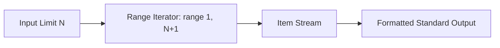

<p align="center">
  
</p>

<p align="center">
  
  
  
  
</p>

---

## Executive Summary / Overview
### Problem Statement & Context
Generating numerical series is one of the primary tasks in computational programming. When operating at scale, generating sequences via naive memory buffering can quickly consume excessive RAM, demanding lazy stream generator patterns.

### Solution Overview
This repository presents clean, efficient implementations for **Generating Numerical Series** in Python. It analyzes range bounds, sequence formatting, and memory consumption when producing linear series up to N.

---

## Interactive Table of Contents
- [Executive Summary / Overview](#executive-summary--overview)
- [Key Features & Capabilities](#key-features--capabilities)
- [System Architecture / Pipeline](#system-architecture--pipeline)
- [Tech Stack Breakdown](#tech-stack-breakdown)
- [Reproducible Quickstart & Setup](#reproducible-quickstart--setup)
- [Project Directory Layout](#project-directory-layout)
- [Author & Contributions](#author--contributions)

---

## Key Features & Capabilities
- **Linear Sequence Generation:** Deterministic generation of numbers from 1 to N with customizable step sizes.
- **Minimal Space Overhead:** Implements iterative streaming with O(1) auxiliary space complexity.
- **Edge-Case Tolerance:** Gracefully handles non-positive bounds and single-element ranges.

---

## System Architecture / Pipeline


---

## Tech Stack Breakdown
| Layer | Technology | Details |
| :--- | :--- | :--- |
| **Languages** | Python 3.10+ | Pure Python standard library |
| **Libraries** | Built-in Range Primitives | Generator expressions and iterators |
| **Tools** | Jupyter Notebook | Interactive execution and validation |
| **Architecture** | Stream Generator Pipeline | Lazy linear iteration with O(1) auxiliary RAM |

---

## Reproducible Quickstart & Setup
```bash
# 1. Clone repository
git clone https://github.com/suryateja-155/print-n-numbers.git
cd print-n-numbers

# 2. Run notebook
jupyter notebook "print n numbers.ipynb"
```

---

## Project Directory Layout
```text
print-n-numbers/
├── print n numbers.ipynb   # Sequence generation and formatting notebook
└── README.md               # Technical overview and algorithmic complexity
```

---

## Author & Contributions

**Gettupalli Surya Teja**  
- GitHub Profile: [@suryateja-155](https://github.com/suryateja-155)  
- Portfolio Index: [Gettupalli-Surya-Teja](https://github.com/suryateja-155/Gettupalli-Surya-Teja)

Contributions, issue reports, and feedback are always welcome! Feel free to open an issue or pull request.

<p align="center">
  
</p>
